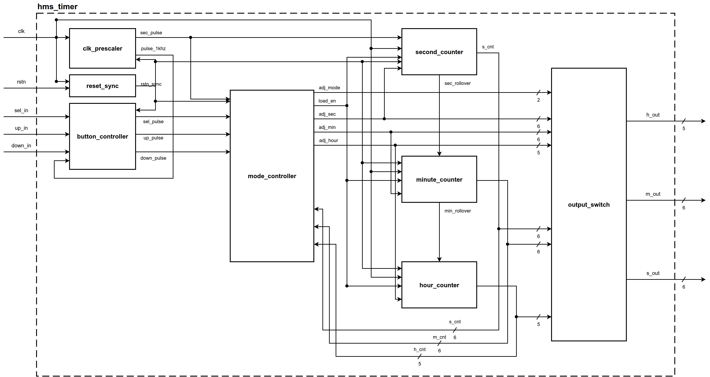

# Hour-Minute-Second Timer (`HMS_Timer`) IP Core & Verification Environment (Universal Synchronous Architecture)

[](https://en.wikipedia.org/wiki/SystemVerilog)
[]()
[]()
[]()
[-blue.svg)]()
[-blueviolet.svg)]()
[]()

IP Core bộ đếm thời gian thực **Giờ - Phút - Giây (Hour-Minute-Second Timer)** chuẩn công nghiệp bán dẫn, thiết kế hoàn toàn bằng ngôn ngữ phần cứng **SystemVerilog Synthesizable** và được kiểm chứng toàn diện với môi trường **SystemVerilog Verification Environment** (Interface, Clocking Blocks, Driver, Golden Model Scoreboard, Functional Coverage, SystemVerilog Assertions).

**Universal Synchronous Architecture** chuẩn hóa kiến trúc **Đơn miền xung nhịp thuần túy với Bộ tạo xung cho phép (Single-Clock Synchronous with Native Clock Enable / Pulse Generator)** kết hợp **Tách biệt Bộ Đệm Chỉnh Giờ & Chuyển Mạch Hiển Thị ([`output_switch`](file:///home/ngobinh/HMS_Timer/rtl/output_switch.sv))**:
- **Đơn miền xung nhịp đồng bộ 1 MHz toàn cục (Single Clock Domain):**
  * Toàn bộ Flip-Flop trong chip chạy đồng nhất trên 1 xung nhịp gốc 1 MHz (`clk`). Không tạo ra clock con, không có ripple clock, triệt tiêu 100% nguy cơ Clock Domain Crossing (CDC), Clock Skew và Hold Violations.
  * Tối ưu hoàn hảo cho cả **FPGA** (dùng 1 bộ đệm `BUFG` duy nhất, map vào chân `CE` của slice `FDRE`) và **ASIC** (tương thích 100% tính năng Automatic Clock Gating của Synopsys Design Compiler / Cadence Genus).
- **Bộ Đồng Bộ Hóa Reset ([`reset_sync`](file:///home/ngobinh/HMS_Timer/rtl/reset_sync.sv) - 2-Stage D-FF):**
  * Đồng bộ hóa tín hiệu reset thô bất đồng bộ ngoại vi (`rstn`) theo sườn dương xung nhịp 1 MHz.
  * Triệt tiêu hoàn toàn vi phạm Recovery/Removal Time và chống hiện tượng bất ổn định (Metastability) toàn chip.
- **Khối Chuyển Mạch Hiển Thị Chuyên Dụng ([`output_switch`](file:///home/ngobinh/HMS_Timer/rtl/output_switch.sv))**:
  * Khi ở chế độ chỉnh sửa (`MODE_ADJ_*`), các ngõ ra hiển thị trực tiếp giá trị từ bộ đệm chỉnh sửa ([`mode_controller`](file:///home/ngobinh/HMS_Timer/rtl/mode_controller.sv)) giúp người dùng theo dõi trực quan và tức thời.
  * Khi ở chế độ đếm thời gian thực (`MODE_RUN`), các ngõ ra hiển thị giá trị từ các bộ đếm nền thời gian thực.
- **Bộ Đếm Nền Liên Tục Chuẩn Xác (Zero-Drift Background Clock)**:
  * Các khối [`second_counter`](file:///home/ngobinh/HMS_Timer/rtl/second_counter.sv), [`minute_counter`](file:///home/ngobinh/HMS_Timer/rtl/minute_counter.sv), [`hour_counter`](file:///home/ngobinh/HMS_Timer/rtl/hour_counter.sv) đếm thời gian thực liên tục 24/7 ở chế độ nền. Không bị dừng hay trôi thời gian khi người dùng đang thao tác trong menu.
  * Loại bỏ hoàn toàn các thanh ghi bóng (shadow snapshot registers), tiết kiệm Flip-Flops và cổng logic.
- **Nạp Song Song Đồng Bộ Khi Xác Nhận (Commit on Loop Exit)**:
  * Khi người dùng duyệt hết chu trình chỉnh giờ (`ADJ_HOUR` -> `MODE_RUN`), [`mode_controller`](file:///home/ngobinh/HMS_Timer/rtl/mode_controller.sv) phát xung 1-cycle `load_en = 1`, nạp song song toàn bộ thời gian đã chỉnh vào các bộ đếm.
- **Hủy Bỏ & Khôi Phục Hiển Thị Tự Động Sau 5s (5s Inactivity Timeout)**:
  * Nếu người dùng không thao tác phím trong 5s, FSM tự động quay về `MODE_RUN` với `load_en = 0` (hủy bỏ bộ đệm), bộ MUX tự động chuyển lại hiển thị bộ đếm nền đang chạy chuẩn xác.
- **Khử rung nút bấm chuyên dụng 20ms với Dung sai ±10% (`1kHz-Sampled 20ms ±10% Debounce`)**:
  * Tần số lấy mẫu: 1 kHz (1 ms qua `pulse_1khz`). Ngưỡng lọc rung: 20 xung mẫu (20 ms). Triệt tiêu 100% glitch và ngăn chặn kích hoạt tự lặp (no auto-repeat).

---

## 1. Cấu trúc thư mục dự án (Directory Structure)

```text
HMS_Timer/
├── README.md                      # Tài liệu tổng quan kiến trúc và hướng dẫn kiểm chứng
├── Makefile                       # Build script tự động cho QuestaSim (sim, cov, wave, OpenLane)
├── docs/                          # Tài liệu thiết kế đặc tả kiến trúc & Kế hoạch kiểm chứng
│   ├── SPECIFICATION.md           # Đặc tả thiết kế RTL chi tiết chuẩn Spec-First (Draw.io + WaveDrom)
│   ├── SPECIFICATION.docx         # Tài liệu Word biên dịch từ Markdown chuẩn công nghiệp
│   ├── HMS_Timer_Test_Plan_Expanded.xlsx # Bảng phân rã 133 hạng mục kiểm thử chi tiết
│   ├── HMS_Timer_Test_Plan_Review.md     # Đánh giá & rà soát ma trận kiểm thử
│   ├── diag_*.png                 # Sơ đồ khối Draw.io độ phân giải cao cho Top & 9 Submodules
│   └── timing_*.png               # Giản đồ thời gian WaveDrom hiển thị dạng sóng chu kỳ
├── rtl/                           # Mã nguồn RTL Synthesizable (Universal Synchronous Architecture)
│   ├── reset_sync.sv              # Khối đồng bộ hóa reset 2-FF chống Metastability
│   ├── clk_prescaler.sv           # Bộ chia tần phân tầng: 1 MHz -> pulse_1khz (1 kHz) -> sec_pulse (1 Hz)
│   ├── button_debouncer.sv        # Khối đồng bộ 2-FF & Khử rung 20ms với xung lấy mẫu pulse_1khz
│   ├── button_controller.sv       # Tích hợp 3 kênh nút bấm (sel, up, down) & căn xung 1 MHz đồng bộ
│   ├── mode_controller.sv         # FSM 4 chế độ, bộ đệm chỉnh giờ độc lập, giải quyết xung đột & Timeout 5s
│   ├── second_counter.sv          # Bộ đếm Giây Modulo-60 nền & Synchronous Parallel Load
│   ├── minute_counter.sv          # Bộ đếm Phút Modulo-60 nền & Synchronous Parallel Load
│   ├── hour_counter.sv            # Bộ đếm Giờ Modulo-24 nền & Synchronous Parallel Load
│   ├── output_switch.sv           # Bộ chuyển mạch đa hợp hiển thị tổ hợp không trễ (Display MUX)
│   └── hms_timer.sv               # Top-level IP Core thuần kết nối cấu trúc (Pure Structural)
├── tb/                            # Môi trường kiểm chứng SystemVerilog nâng cao
│   ├── hms_timer_types_pkg.sv     # Package định nghĩa kiểu dữ liệu, enum FSM, hằng số và loggers
│   ├── hms_timer_if.sv            # Interface chứa Clocking blocks, probe signals & 24 luật SVA
│   ├── hms_driver.sv              # Class Driver phát stimulus, xung nút bấm và điều khiển Reset
│   ├── hms_scoreboard.sv          # Class Scoreboard đối chiếu Golden Model chu kỳ chính xác
│   ├── hms_coverage.sv            # Class Functional Coverage Model (4 Covergroups, 74 bins)
│   ├── tb_hms_timer.sv            # Top Testbench Runner hỗ trợ chọn test qua +TESTNAME=<name>
│   └── tests/                     # Phân hệ kiểm thử mô-đun hóa tương ứng 133 hạng mục
│       ├── tc_sec1_reset_clock.sv      # Mục 1: Reset & Khân tầng Clock (26 items)
│       ├── tc_sec2_button_debouncer.sv # Mục 2: Khử rung & Xử lý Nút bấm (26 items)
│       ├── tc_sec3_fsm_timeout.sv      # Mục 3: FSM & Quản lý Timeout 5s (22 items)
│       ├── tc_sec4_buffers_display.sv  # Mục 4: Bộ đệm & Chuyển mạch MUX (18 items)
│       ├── tc_sec5_counters_cascade.sv # Mục 5: Bộ đếm nền & Rollover (21 items)
│       └── tc_sec6_integration_sva.sv  # Mục 6: Tích hợp Hệ thống & SVA (20 items)
├── repo_map.md                    # Bản đồ phân tầng và vai trò từng tệp trong kho mã nguồn
├── rtl_hierarchy.md               # Sơ đồ phân cấp thực thể phần cứng và giao tiếp tín hiệu
├── design_intent.md               # Căn cứ thiết kế, tối ưu PPA và phân tích kiến trúc
├── common_failures.md             # Sổ tay tổng hợp các lỗi tiềm ẩn và cách khắc phục
└── debug_checklist.md             # Danh mục rà soát thiết kế và kiểm thử trước khi bàn giao
```

---

## 2. Sơ đồ khối kiến trúc kết nối Tổng quan

Kiến trúc phần cứng được thiết kế theo cấu trúc phân tầng rõ ràng, kết nối qua sơ đồ khối trực quan:



---

## 3. Hướng dẫn Chạy Mô phỏng (Simulation & Verification)

### Biên dịch và Chạy Testbench với QuestaSim:
```bash
# 1. Biên dịch toàn bộ RTL và Testbench
make compile

# 2. Chạy hồi quy toàn bộ 133 bài test và xuất báo cáo
make sim

# 3. Biên dịch và chạy thu thập Code & Functional Coverage
make cov

# 4. Mở báo cáo HTML Coverage trực tiếp trên trình duyệt
make cov-view

# 5. Mở trực tiếp trang Functional Coverage & Covergroup Bins
make cov-view-cvg

# 6. Mở giao diện sóng QuestaSim Waveform GUI để debug
make wave

# 7. Dọn dẹp thư viện biên dịch và logs
make clean
```

### Chạy từng Hạng mục Kiểm thử Độc lập:
```bash
# Chạy riêng phân hệ kiểm thử FSM & Timeout
make sim TEST=tc_sec3_fsm_timeout

# Chạy riêng phân hệ kiểm thử Khử rung nút bấm
make sim TEST=tc_sec2_button_debouncer
```

---

## 4. Kết quả Kiểm chứng Toàn diện (Verification Scorecard)

Dưới đây là kết quả kiểm thử tự động thực tế từ bộ công cụ **QuestaSim 2021.2_1**:

```text
================================================================================
                    OVERALL TESTCASE EXECUTION SUMMARY                           
================================================================================
 TOTAL TESTCASES EXECUTED : 133
 PASSED TESTCASES         : 133
 FAILED TESTCASES         : 0
--------------------------------------------------------------------------------

================================================================================
                    VERIFICATION SCORECARD & SUMMARY REPORT                      
================================================================================
 TOTAL ASSERTIONS & CHECKS RUN : 367
 TOTAL PASSED CHECKS           : 367
 TOTAL FAILED CHECKS           : 0
--------------------------------------------------------------------------------
 >>> VERIFICATION STATUS: 100% PASSED (TAPE-OUT READY QUALITY) <<< 
================================================================================
```

### Báo cáo Độ bao phủ Toàn diện (Coverage Summary):

| Hạng mục Độ bao phủ (Coverage Metric) | Mục tiêu | Số Bins / Items | Đạt (Hits) | Chưa đạt (Misses) | Tỷ lệ Đạt (%) |
| :--- | :---: | :---: | :---: | :---: | :---: |
| **SVA SystemVerilog Assertions** | 100.0% | 24 | 24 | 0 | **100.00%** |
| **FSM States Coverage** | 100.0% | 4 | 4 | 0 | **100.00%** |
| **FSM Transitions Coverage** | 100.0% | 6 | 6 | 0 | **100.00%** |
| **Functional Coverage (Covergroups)** | 100.0% | 74 | 74 | 0 | **100.00%** |
| - *cg_fsm_modes (FSM Operating Modes)* | 100.0% | 15 | 15 | 0 | *100.00%* |
| - *cg_time_values (Boundaries & Wraps)* | 100.0% | 15 | 15 | 0 | *100.00%* |
| - *cg_stimulus_cross (Button x Mode)* | 100.0% | 31 | 31 | 0 | *100.00%* |
| - *cg_commit_collision (Load x Rollover)* | 100.0% | 13 | 13 | 0 | *100.00%* |
| **Condition Coverage** | 100.0% | 37 | 37 | 0 | **100.00%** |
| **Statement Coverage** | >= 95.0% | 127 | 126 | 1 | **99.21%** |
| **Branch Coverage** | >= 95.0% | 138 | 133 | 5 | **96.37%** |
| **Expression Coverage** | Excluded | 11 | 8 | 3 | **72.72%** |
| **Tổng thể Mã nguồn & Chức năng (Overall)** | >= 95.0% | - | - | - | **96.03% (SIGN-OFF READY)** |
