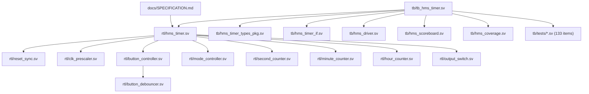

# Repository Map & Architecture Mapping (Universal Synchronous Architecture)

## 1. Directory Structure

```text
HMS_Timer/
├── README.md                          # Tổng quan dự án, hướng dẫn mô phỏng và scorecard
├── Makefile                           # Build script tự động hóa biên dịch, mô phỏng, coverage
├── repo_map.md                        # Bản đồ phân tầng và trách nhiệm từng tệp
├── rtl_hierarchy.md                   # Phân cấp module và ma trận kết nối tín hiệu
├── design_intent.md                   # Căn cứ thiết kế, tối ưu PPA và phân tích kiến trúc
├── common_failures.md                 # Sổ tay tổng hợp lỗi và phương pháp phòng ngừa
├── debug_checklist.md                 # Danh mục kiểm tra trước khi bàn giao
├── docs/                              # Tài liệu đặc tả và kế hoạch kiểm chứng
│   ├── SPECIFICATION.md               # Tài liệu Đặc tả Kiến trúc chi tiết (Spec-First)
│   ├── SPECIFICATION.docx             # Tài liệu Word biên dịch từ SPECIFICATION.md
│   ├── HMS_Timer_Test_Plan_Expanded.xlsx # Kế hoạch phân rã 133 hạng mục kiểm thử
│   ├── HMS_Timer_Test_Plan_Review.md  # Đánh giá & rà soát ma trận kiểm thử
│   ├── diag_*.png                     # Sơ đồ khối Draw.io độ phân giải cao
│   └── timing_*.png                   # Giản đồ thời gian WaveDrom
├── rtl/                               # Mã nguồn RTL Synthesizable (SystemVerilog)
│   ├── reset_sync.sv                  # Bộ đồng bộ hóa Reset 2-FF chống Metastability
│   ├── clk_prescaler.sv               # Bộ chia tần đa tầng: 1 MHz -> pulse_1khz (1 kHz) -> sec_pulse (1 Hz)
│   ├── button_debouncer.sv            # Bộ lọc rung 20ms với xung lấy mẫu pulse_1khz (5-bit counter)
│   ├── button_controller.sv           # Bộ điều khiển 3 kênh nút bấm phát xung 1 chu kỳ 1 MHz
│   ├── mode_controller.sv             # FSM 4 chế độ, bộ đệm chỉnh giờ độc lập & Timeout 5s
│   ├── second_counter.sv              # Bộ đếm Giây Modulo-60 nền & Synchronous Parallel Load
│   ├── minute_counter.sv              # Bộ đếm Phút Modulo-60 nền & Synchronous Parallel Load
│   ├── hour_counter.sv                # Bộ đếm Giờ Modulo-24 nền & Synchronous Parallel Load
│   ├── output_switch.sv               # Bộ ghép kênh hiển thị tổ hợp không trễ (Display MUX)
│   └── hms_timer.sv                   # Top-level IP Core thuần kết nối cấu trúc 100%
└── tb/                                # Môi trường kiểm chứng SystemVerilog
    ├── hms_timer_types_pkg.sv         # Định nghĩa kiểu dữ liệu, enum FSM, loggers
    ├── hms_timer_if.sv                # Interface SystemVerilog kết hợp Clocking Blocks & 24 SVA
    ├── hms_driver.sv                  # Driver điều khiển stimulus và reset
    ├── hms_scoreboard.sv              # Scoreboard chu kỳ chính xác đối chiếu Golden Model
    ├── hms_coverage.sv                # Functional Coverage Model (4 Covergroups, 74 bins)
    ├── tb_hms_timer.sv                # Top Testbench Runner hỗ trợ command-line +TESTNAME
    └── tests/                         # Phân hệ kiểm thử 133 hạng mục
        ├── tc_sec1_reset_clock.sv     # Phân hệ 1: Quản lý Reset & Clock (26 items)
        ├── tc_sec2_button_debouncer.sv# Phân hệ 2: Khử rung & Nút bấm (26 items)
        ├── tc_sec3_fsm_timeout.sv     # Phân hệ 3: FSM & Inactivity Timeout 5s (22 items)
        ├── tc_sec4_buffers_display.sv # Phân hệ 4: Bộ đệm & Chuyển mạch MUX (18 items)
        ├── tc_sec5_counters_cascade.sv# Phân hệ 5: Bộ đếm nền & Rollover (21 items)
        └── tc_sec6_integration_sva.sv # Phân hệ 6: Tích hợp Hệ thống & SVA (20 items)
```

---

## 2. File Responsibilities & Inter-dependencies


